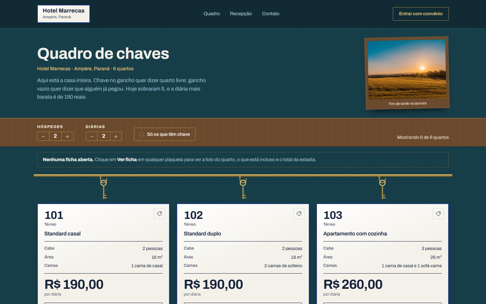
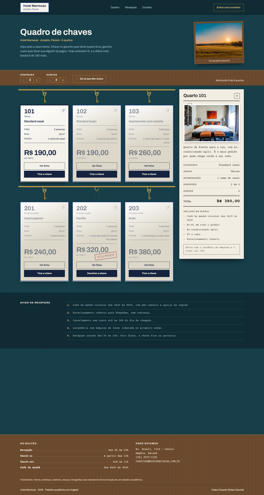
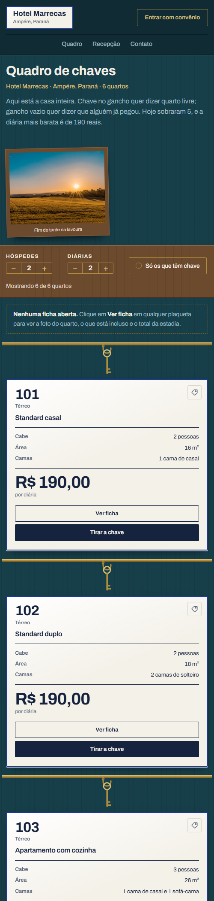

# Hotel Marrecas — Quadro de Chaves

Sistema de reserva de quartos de um hotel pequeno, feito em Angular.

A tela principal imita o **quadro de chaves da recepção**: cada quarto é um
gancho na tábua. Chave pendurada quer dizer quarto livre; gancho vazio quer
dizer que alguém já pegou. É a forma mais direta de mostrar disponibilidade num
hotel que tem seis quartos, e é assim que a recepção de verdade controla isso.

## Aluno

Felipe Eduardo Sfolias Stachak

## Descrição

O hotel fica em Ampére, no sudoeste do Paraná, e atende principalmente quem
viaja a trabalho pela região e famílias que recebem parentes. A aplicação mostra
a casa inteira numa tela só:

- **Quartos** — seis, divididos por andar, com número, categoria e descrição;
- **Valores** — a diária de cada quarto, com tarifa reduzida para empresas
  conveniadas;
- **Capacidade** — quantas pessoas cabem, o tipo de cama e a metragem;
- **Disponibilidade** — chave no gancho ou gancho vazio, com o carimbo
  *Ocupado* na plaqueta;
- **Benefícios** — o que está incluso na diária, listado na ficha do quarto.

> O hotel é fictício. Nome, endereço, telefone e preços são material de
> demonstração do trabalho.

## Funcionalidades

- **Quadro de chaves** montado a partir dos dados declarados no TypeScript.
- **Ficha de hospedagem**: clicar em *Ver ficha* abre o painel com a foto do
  quarto, os benefícios inclusos e o total da estadia.
- **Tirar e devolver a chave**, alternando a disponibilidade do quarto.
- **Separar quartos** com a etiqueta, e uma faixa que só aparece quando existe
  pelo menos um quarto separado.
- **Convênio de empresa** (login fictício): ao entrar, o nome do hóspede aparece
  no cabeçalho e todas as diárias passam a mostrar 10% de desconto.
- **Contadores de hóspedes e de diárias**, que recalculam o total da estadia.
- **Filtro** para mostrar só os quartos que ainda têm chave no gancho.
- **Aviso de capacidade**: quando o grupo é maior do que o quarto comporta, o
  botão de tirar a chave é desabilitado e a plaqueta explica o motivo.
- **Layout responsivo**, do desktop ao celular.

## Tecnologias

- Angular 21 (componentes standalone)
- TypeScript
- HTML semântico
- CSS puro, com Flexbox e Grid — sem frameworks e sem bibliotecas externas

## Como executar

1. Baixe ou clone o repositório.
2. Abra a pasta do projeto no terminal.
3. Execute `npm install`.
4. Execute `ng serve`.
5. Acesse `http://localhost:4200`.

> As fotos dos quartos são carregadas por URL do Unsplash, então é preciso estar
> conectado à internet para vê-las.

## Organização do projeto

O projeto é dividido por área: o que é moldura da página fica em `layout/`, e
tudo que diz respeito a quartos fica junto em `quartos/`.

```
src/app/
├── app.ts / app.html / app.css        componente principal
├── layout/
│   ├── cabecalho/                     placa do hotel, menu e botão de convênio
│   └── rodape/                        horários e contato
└── quartos/
    ├── quarto.model.ts                a interface Quarto
    ├── quarto.service.ts              os dados dos quartos e as operações
    ├── quadro-chaves/                 a página: balcão, quadro e avisos
    ├── chave-quarto/                  um gancho, a chave e a plaqueta
    └── ficha-quarto/                  a ficha de hospedagem em papel
```

### Componentes

| Componente | Responsabilidade |
|---|---|
| `App` | Componente principal. Guarda o convênio e monta a página. |
| `Cabecalho` | Placa esmaltada do hotel, navegação e botão de entrar/sair. |
| `QuadroChaves` | A área principal: contadores, filtro, o quadro e o aviso da recepção. |
| `ChaveQuarto` | Um quarto: o gancho, a chave pendurada e a plaqueta com os dados. |
| `FichaQuarto` | A ficha de hospedagem, com foto, benefícios e total da estadia. |
| `Rodape` | Horários de atendimento e contato. |

Os dados dos quartos ficam em `QuartoService`, um arquivo TypeScript que também
concentra as operações de tirar a chave e separar o quarto. Os componentes só
leem essa lista e pedem as alterações por lá.

## Onde cada requisito foi aplicado

| Requisito | Onde encontrar |
|---|---|
| Interpolação | `quadro-chaves.html`: `{{ nomeHotel }}`, `{{ quartosComChave }}`, `{{ menorDiaria }}` · `chave-quarto.html`: `{{ quarto.numero }}` |
| Property binding | `chave-quarto.html`: `[quarto]`, `[disabled]="!cabeOGrupo && quarto.disponivel"`, `[class.chaveiro--vago]` · `ficha-quarto.html`: `[src]="quarto.imagem"`, `[alt]` |
| Event binding | `chave-quarto.html`: `(click)="alternarChave.emit(quarto)"` · `quadro-chaves.html`: `(click)="aumentarHospedes()"` · `cabecalho.html`: `(click)="clicarConvenio()"` |
| `@if` / `@else` | `chave-quarto.html`: a chave só é desenhada se o quarto estiver livre, e o carimbo *Ocupado* só aparece se não estiver · `cabecalho.html`: saudação do convênio · `ficha-quarto.html`: os três recados da estadia · `quadro-chaves.html`: ficha aberta ou aviso de nenhuma ficha |
| `@for` / `@empty` | `quadro-chaves.html`: os quartos do quadro · `ficha-quarto.html`: os benefícios |
| Condição alterada por botão | `alternarConvenio()` em `app.ts` · `alternarChave()` e `alternarFavorito()` em `quarto.service.ts` |
| HTML semântico | `header`, `nav`, `main`, `section`, `article`, `aside`, `address`, `figure`, `footer` |
| CSS | `src/styles.css` com as variáveis de cor e tipografia, e um arquivo `.css` por componente |

## Sobre o visual

A identidade sai de um objeto real da recepção de hotel pequeno:

- a **tábua pintada** a óleo é o fundo da página;
- as **plaquetas esmaltadas** brancas com aro azul carregam os dados do quarto;
- os **ganchos e as chaves de latão** mostram a disponibilidade;
- a **ficha de hospedagem em papel** é o painel de detalhes.

São duas fontes, cada uma com um trabalho, e elas não se misturam:
**Archivo** para o que está pintado ou esmaltado na tábua, e **Courier Prime**,
de máquina de escrever, para o que foi preenchido em papel — a ficha, os
horários e o aviso da recepção.

Cada estado tem a sua cor e ela não aparece em mais nada: vermelho é do carimbo
de ocupado, verde é do convênio, âmbar é da falta de espaço, e a plaqueta
escolhida fecha em tinta cheia enquanto as outras recuam.

As fotografias são do Unsplash, sob a Licença Unsplash; os códigos de cada foto
estão anotados em `quarto.service.ts`.

## Imagens da aplicação

O quadro de chaves, com os dois andares:



A ficha de hospedagem aberta, com os benefícios e o total da estadia:



O mesmo quadro em tela estreita, com uma coluna só:



## Vídeo

Link do vídeo publicado no YouTube: _(adicionar o link aqui)_
